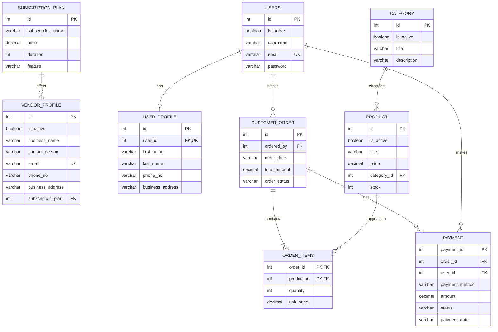

Multi-Vendor E-Commerce Database
A PostgreSQL database project for a multi-vendor e-commerce platform. It
models vendors and subscription plans, customer accounts and profiles,
product categories, products, orders, order items, and payments.
Project status: Database design and sample SQL queries are in
progress. Review the setup notes below before running the full script:
the pasted SQL contains a few ordering/syntax issues and some sample
records that conflict with foreign-key relationships.

✨ Features
- Vendor profiles linked to subscription plans
- User registration data and separate user profiles
- Product categories and product listings
- Orders linked to customers
- Order items that record quantity and unit price
- Payment records linked to an order and a user
- SQL queries for category/product listings, order details, and
  best-selling products
🧰 Tech stack
- Database: PostgreSQL
- Language: SQL
- Modeling: Entity Relationship Diagram (ERD)
🗺️ Database ER diagram
The diagram below represents the relationships intended by the current
table definitions. GitHub renders Mermaid diagrams directly in Markdown.

Relationship summary
  Relationship                        Meaning
  Subscription plan → Vendor          One plan can be assigned to
                                      multiple vendors; each vendor
                                      references one plan.
  User → User profile                 user_profile.user_id is unique,
                                      so a user can have at most one
                                      profile.
  User → Order                        One user can place many orders.
  Order → Order items                 An order can contain multiple line
                                      items.
  Product → Order items               A product can appear in many order
                                      line items.
  Category → Product                  Each product references one
                                      category in the current schema; a
                                      category can contain many products.
  Order → Payment                     An order can have multiple payment
                                      records.
  User → Payment                      A user can have multiple payment
                                  records.
📊 Example SQL queries
1. Vendors with their subscription plans
SELECT
    v.business_name,
    v.contact_person,
    s.subscription_name,
    s.price
FROM vendor_profile AS v
JOIN subscription_plan AS s
    ON v.subscription_plan = s.id;
2. Products with category names
SELECT
    c.title AS category_title,
    p.title AS product_name,
    p.price
FROM category AS c
JOIN product AS p
    ON p.category_id = c.id;
3. Top-selling products by quantity
SELECT
    p.id AS product_id,
    p.title AS product_name,
    SUM(oi.quantity) AS total_quantity_sold
FROM order_items AS oi
JOIN product AS p
    ON p.id = oi.product_id
GROUP BY p.id, p.title
ORDER BY total_quantity_sold DESC
LIMIT 5;
4. Itemized order details
SELECT
    o.id AS order_id,
    u.username,
    p.title AS product_name,
    oi.quantity,
    oi.unit_price,
    oi.quantity * oi.unit_price AS item_total,
    o.order_status
FROM "Order" AS o
JOIN users AS u
    ON u.id = o.ordered_by
JOIN order_items AS oi
    ON oi.order_id = o.id
JOIN product AS p
    ON p.id = oi.product_id
ORDER BY o.id, p.title;
🚀 Setup
1. Install PostgreSQL and open pgAdmin or psql.
2. Create or select a database for this project.
3. Run the SQL in dependency order:
   1. subscription_plan
   2. vendor_profile
   3. users
   4. user_profile
   5. category
   6. product
   7. "Order"
   8. order_items
   9. payment
4. Insert parent records before inserting records that reference them.
5. Run the example queries to inspect the results.
⚠️ Before running the current SQL script
A few fixes are needed for a clean run:
- Create Product before altering it. The script currently tries
  to alter Product before creating the table. Add
  stock INTEGER NOT NULL DEFAULT 0 inside the CREATE TABLE Product
  definition, or run the ALTER TABLE after the table exists.
- Remove the incomplete ALTER TABLE line and the stray Pay
  line in the Payment table definition.
- Keep foreign keys consistent. The script deletes the
  oldcustomer user but later inserts a profile referencing user ID
  2. That insert will fail if the deletion succeeded.
- Check order totals. Some Order.total_amount values do not
  match the sum of their associated order items. For example,
  calculate totals from quantity * unit_price and keep the stored
  total in sync.
- Check payment totals. Payment amounts should agree with the
  related order and payment status.
- Use date/time types for dates. Consider changing order_date
  and payment_date from VARCHAR(50) to DATE or TIMESTAMP.
- Hash passwords in the application. Never store real user
  passwords as plain text. The sample hashed_pass_123 values are
  placeholders, not secure password hashes.
- Clarify vendor-product ownership. The current Product table
  has no vendor_id, so it does not yet connect each product to a
  vendor. For a true multi-vendor marketplace, add a foreign key such
  as vendor_id INTEGER REFERENCES vendor_profile(id) to Product.
- Consider stock and line-item constraints. Add checks such as
  quantity > 0, price >= 0, and stock >= 0.
🔮 Possible next improvements
- Add vendor_id to products to model product ownership.
- Add constraints for non-negative prices, quantities, and stock.
- Use GENERATED ... AS IDENTITY for automatically generated primary
  keys.
- Add indexes to frequently used foreign-key columns.
- Calculate order totals from order items in application logic or with
  a carefully designed database strategy.
- Add a README screenshot of the ERD if a static diagram is
  preferred over Mermaid.
📁 Suggested project structure
multi-vendor-ecommerce-db/
├── README.md
├── sql/
│   ├── 01_subscription_plan.sql
│   ├── 02_vendor_profile.sql
│   ├── 03_users_and_profiles.sql
│   ├── 04_category_and_product.sql
│   ├── 05_orders_and_order_items.sql
│   ├── 06_payment.sql
│   └── 07_sample_queries.sql
└── docs/
    └── erd.png
Built as a learning project to practice relational database design,
primary and foreign keys, joins, aggregation, and reporting queries.