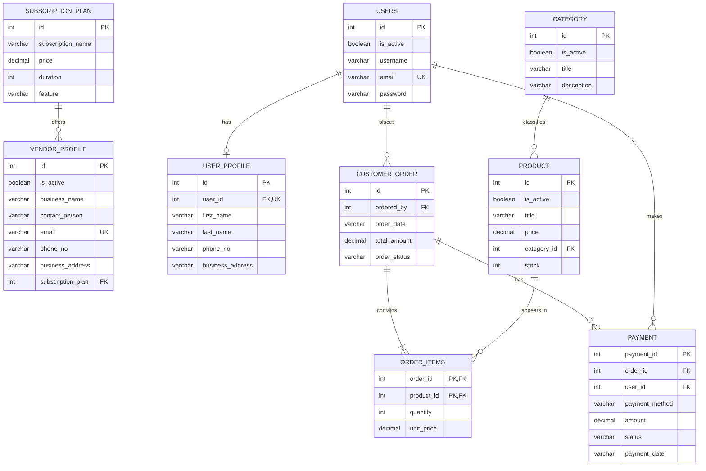

Multi-Vendor E-Commerce Database
A PostgreSQL database project for a multi-vendor e-commerce platform. It
models vendors and subscription plans, customer accounts and profiles,
product categories, products, orders, order items, and payments.
Project status: Database design and sample SQL queries are in
progress. Review the setup notes below before running the full script:
the pasted SQL contains a few ordering/syntax issues and some sample
records that conflict with foreign-key relationships.

✨ Features
- Vendor profiles linked to subscription plans
- User registration data and separate user profiles
- Product categories and product listings
- Orders linked to customers
- Order items that record quantity and unit price
- Payment records linked to an order and a user
- SQL queries for category/product listings, order details, and
  best-selling products
🧰 Tech stack
- Database: PostgreSQL
- Language: SQL
- Modeling: Entity Relationship Diagram (ERD)
🗺️ Database ER diagram
The diagram below represents the relationships intended by the current
table definitions. GitHub renders Mermaid diagrams directly in Markdown.

What I Learned:
- Designing relational tables with Primary Keys and Foreign
  Keys
- Connecting related tables using INNER JOIN
- Using UNIQUE and NOT NULL constraints
- Working with INSERT, UPDATE, DELETE, and SELECT
- Using GROUP BY, SUM, ORDER BY, and LIMIT to find
  top-selling products
- Modeling users, vendors, products, orders, order items, and payments

Challenges I Faced:
- Table creation order: A table must exist before altering it or
  referencing it with a foreign key. I learned to create tables in
  dependency order.
- Foreign-key errors: Related records must exist first. I learned
  to insert parent records before child records and check references
  before deleting data.
- Finding related information: Some details live in separate
  tables, so I used JOIN to retrieve combined results.
- Sales reporting: I used SUM() and GROUP BY to calculate the
  quantity sold per product.
- Data consistency: Order totals should match the sum of their
  order items, and payment amounts should match the intended payment
  records.

  Run the Project
1. Install PostgreSQL and open pgAdmin or psql.
2. Create a database, for example ecommerce_db.
3. Open the SQL files in the order below, or run the complete script
   after fixing the issues listed in the next section:
   - subscription_plan
   - vendor_profile
   - users
   - user_profile
   - category
   - product
   - "Order"
   - order_items
   - payment
4. Execute the CREATE TABLE statements first, then insert sample
   data.
5. Run the example SELECT queries to check the results.
Note: In pgAdmin, select your database, open Query Tool, paste
the SQL, and click Execute (▶).

Future Plan:
I plan to use this database as the foundation for a working e-commerce
website/application. Next, I want to connect it to a backend (for
example, Django or FastAPI) and build features such as user
registration/login, vendor product management, product browsing, cart
and checkout, order tracking, and payment-status management. I also plan
to improve validation, security, and stock handling.